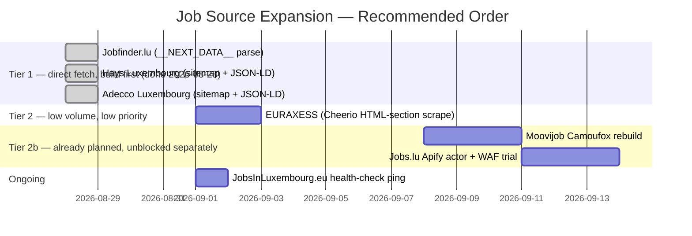

# Job Source Ingestion Strategy

Technical feasibility research and implementation plan for expanding EU WorkMe's
ingestion coverage beyond EURES + Silicon Luxembourg, covering the 11 sources
requested for evaluation. All findings below are from live verification (fetching
real `robots.txt` files, job pages, sitemaps, and APIs on 2026-08-28) — not
assumptions from general knowledge of these sites.

**Status: Tier 1 built and live (2026-08-28).** Jobfinder.lu, Hays Luxembourg,
and Adecco Luxembourg are implemented and wired into `orchestrator.ts`'s
`DIRECT_FETCH_SOURCES`. ADEM open data was investigated and found not viable
(see #2) — the doc originally recommended building it before that verification
happened; it's kept here, corrected, rather than deleted, so the dead end isn't
silently re-investigated later.

**Status: major-employer sources built and live (2026-08-28, second pass).**
A follow-up request asked for eight specific Luxembourg employers plus an
investigation into using Moovijob's companies directory
(`en.moovijob.com/companies`) to discover more. Findings and outcome — see the
"Major employer career pages" section below for full detail per source:

- **Built and live**: Amazon Luxembourg, Cargolux, ArcelorMittal, BGL BNP
  Paribas, CACEIS Luxembourg — all direct-fetch, zero bot protection, same
  `DIRECT_FETCH_SOURCES` pattern as Tier 1.
- **Needs headless-browser/Apify treatment** (added to the existing Camoufox
  backlog, not built yet): Spuerkeess (BCEE), Luxair — both Cornerstone
  OnDemand, same ATS, likely shareable with one connector once built; SES
  Space & Defence — SAP SuccessFactors, AJAX-rendered.
- **Moovijob companies directory: dead end.** `en.moovijob.com/companies`
  returns HTTP 403 with a Cloudflare managed-challenge page — the exact same
  bot wall as Moovijob's job listings, not a separate, more-accessible page.
  It cannot be used to discover companies' own external career-site URLs;
  that would need a different discovery mechanism entirely (a headless
  browser capable of clearing the challenge, or a manually-curated list).

## How to read this document

Every source is scored against the same three questions, because they determine
which of the two integration patterns already in this codebase it fits:

1. **Does structured job data already exist on a plain HTTP fetch** — a JSON API,
   a `__NEXT_DATA__`/SSR JSON blob, or Schema.org `JobPosting` JSON-LD? If yes, it's
   a **`DIRECT_FETCH_SOURCES`** candidate (see `functions/src/ingestion/orchestrator.ts`)
   — cheap, fast, no bot protection to fight. This is how `fetchEuresJobs.ts` and
   `fetchSiliconLuxembourgJobs.ts` work today.
2. **Is the content only reachable via a JS-rendered SPA, and/or actively blocked
   by Cloudflare/Akamai/AWS WAF?** If yes, it needs a headless browser and belongs
   in **`APIFY_SOURCES`** (see `functions/src/ingestion/fetchApifySource.ts`) — the
   pattern already scaffolded for Moovijob, using Camoufox per
   `docs/APIFY_OPTIMIZATION_PLAN.md`.
3. **Is scraping even the right tool** — does an official structured feed already
   exist (government open data, a documented partner API), or is the site itself
   just a re-aggregator of other sources this app already covers?

## Summary table

| # | Source | Category | Verdict | Approach | Volume (LU) | Risk |
|---|---|---|---|---|---|---|
| 1 | **Jobfinder.lu** | Primary local | ✅ Build first | Direct fetch, parse `__NEXT_DATA__` | 406 listings | None |
| 2 | **ADEM open data** (would have replaced ADEM JobBoard + Work in Luxembourg) | Official | ❌ Not viable — corrected 2026-08-28 | N/A — only a skills-microdata extract exists, no real listings | 0 usable listings | N/A |
| 3 | **Hays Luxembourg** | Agency | ✅ Build first | Direct fetch, sitemap + JSON-LD | ~18 listings | Very low |
| 4 | **Adecco Luxembourg** | Agency | ✅ Build first | Direct fetch, LU-specific sitemap + JSON-LD | ~115 listings | Low |
| 5 | **EURAXESS** | Official | 🟡 Build, low priority | Direct fetch, Cheerio HTML-section scrape | Low, intermittent | None |
| 6 | **Moovijob.com** | Primary local | 🟡 Already planned | Apify + Camoufox (rebuild) | Large | Low (once working) |
| 7 | **Jobs.lu** | Primary local | 🟡 Already planned | Apify + Camoufox (build) | Large | Low (once working) |
| 8 | **EURES Luxembourg** | Official | ✅ Already live | Direct fetch, `jv-search` REST API | ~19,300 (6 regions) | None |
| 9 | **JobsInLuxembourg.eu** | Expat board | ⏸ Defer | N/A — inventory is empty | 0 listings | N/A |
| 10 | **Faruse** | Expat board | ❌ Skip | N/A — re-aggregator, no extractable data | Small, non-LU-specific | N/A |
| 11 | **Work in Luxembourg** | Official | ❌ Skip (superseded) | N/A — same underlying pool as #2 | N/A | N/A |
| 12 | **LinkedIn** | Global network | ❌ Do not build | N/A — ToS + case law risk, no self-serve API | N/A | High |
| 13 | **Amazon Luxembourg** | Major employer | ✅ Built and live | Direct fetch, public `amazon.jobs` JSON API | 85 listings | None |
| 14 | **Cargolux** | Major employer | ✅ Built and live | Direct fetch, Oracle Recruiting Cloud REST API | 59 total, 34 LU | None |
| 15 | **ArcelorMittal** | Major employer | ✅ Built and live | Direct fetch, same Oracle API, different tenant | 805 total, 36 LU-filtered | None |
| 16 | **BGL BNP Paribas** | Major employer | ✅ Built and live | Direct fetch, WordPress RSS feed | ~10 listings | None |
| 17 | **CACEIS Luxembourg** | Major employer | ✅ Built and live | Direct fetch, Talentsoft RSS feed (LU-filtered) | 20 listings | None |
| 18 | **Spuerkeess (BCEE)** | Major employer | 🟡 Needs Apify | Cornerstone OnDemand SPA, auth-gated API | Unknown | None (once built) |
| 19 | **Luxair** | Major employer | 🟡 Needs Apify | Same Cornerstone OnDemand platform as #18 | ~50 (est.) | None (once built) |
| 20 | **SES Space & Defence** | Major employer | 🟡 Needs Apify | SAP SuccessFactors, AJAX-rendered | Unknown | None (once built) |
| 21 | **Moovijob companies directory** | Discovery mechanism | ❌ Dead end | N/A — same Cloudflare wall as Moovijob job listings | N/A | N/A |

`5. EURAXESS`, `8. EURES` are already covered elsewhere (EURES is live; EURAXESS
follows the same shape). Rows 13-21 are from a second research pass — see
"Major employer career pages" below for full detail. The rest of this
document explains each verdict.

---

## Tier 1 — Build first (direct fetch, zero new infrastructure)

These four all follow the exact shape of `fetchEuresJobs.ts` /
`fetchSiliconLuxembourgJobs.ts`: a plain `fetch()`, no proxy, no headless browser,
added to `DIRECT_FETCH_SOURCES` in `orchestrator.ts`. This is deliberately the
highest-leverage tier — real, previously-uncovered listing volume for close to zero
marginal engineering or infrastructure cost.

### 1. Jobfinder.lu

**Verdict: build first — best new source found.**

- `robots.txt` only disallows `/backoffice/*`; job search and listing paths are
  fully open.
- It's a Next.js app, but **server-rendered**: every page (search results and job
  detail) embeds a complete JSON payload in a `<script id="__NEXT_DATA__">` tag —
  no headless browser needed, a plain HTTP GET returns everything.
- Search results: `props.pageProps.dehydratedState.queries[0].state.data.offers[]`,
  with `meta.hits` giving the total count (406 at verification time).
- Detail pages (`/en/jobs/<24-char-hex-id>`) embed the full offer object (title,
  HTML description, company) the same way. No JSON-LD `JobPosting`, but the
  `__NEXT_DATA__` blob is equivalent — arguably better, since it's already
  machine-shaped rather than SEO markup.
- No Cloudflare/Akamai/CAPTCHA — plain 200 responses throughout.

**Implementation sketch** (`functions/src/ingestion/fetchJobfinderJobs.ts`, same
shape as `fetchEuresJobs.ts`):

```typescript
async function searchPage(page: number): Promise<JobfinderOffer[]> {
  const response = await fetch(`https://jobfinder.lu/en/jobs?page=${page}`);
  const html = await response.text();
  const match = html.match(
    /<script id="__NEXT_DATA__" type="application\/json">(.+?)<\/script>/s
  );
  if (!match) throw new Error('__NEXT_DATA__ not found — page structure changed');
  const data = JSON.parse(match[1]);
  return data.props.pageProps.dehydratedState.queries[0].state.data.offers;
}
```

Treat the exact `queries[0]` path and the JSON shape as fragile — Next.js dehydrated
query keys can shift across a Jobfinder.lu redeploy. Guard with a clear thrown error
(as above) rather than silently returning nothing, so a schema change surfaces as an
ingestion error instead of a silent zero-jobs day — the same principle already
applied to EURES's `resultsPerPage` overflow handling.

### 2. ADEM open data (replaces "ADEM JobBoard" and "Work in Luxembourg") — correction, not viable

**Verdict: skip. This was wrong in the original version of this document —
corrected 2026-08-28 after actually inspecting the dataset instead of trusting
its name.**

The original research here inferred a raw "declared job offers" dataset existed
on `data.public.lu` based on the description text on ADEM's organization page,
but never opened the dataset itself. Doing that before writing any ingestion
code turned up two hard blockers:

- **ADEM's own JobBoard** requires login for the interactive matching UI (already
  confirmed in `docs/APP_AUDIT.md`) — not scrapable as a UI.
- **"Work in Luxembourg"** (real domain: `workinluxembourg.com`, job board at
  `jobs.workinluxembourg.com`) is a government/Luxinnovation portal layered on
  ADEM's international-recruitment vacancy pool, but it's a client-side React
  SPA with no discoverable API — not scrapable either.
- **The only ADEM dataset actually published on `data.public.lu`** is "Skills
  required in ADEM job vacancies" (`data.public.lu/en/datasets/skills-required-
  in-adem-job-vacancies/`) — verified by fetching its CSV resources directly.
  Each row is a **vacancy_id–skill pair** (`vacancy_id, skill, skill_uri,
  positions, month, year, canton, occupation_code, occupation_label, nace_code,
  nace_label`) — anonymized quarterly research microdata for skill-demand
  analysis, with **no job title, no employer name, no description, and no
  application URL**. There is no way to construct a real, applyable vacancy
  listing from it. A direct dataset search for "offres d'emploi" against
  `data.public.lu`'s own API (`/api/1/datasets/?q=...`) returns zero results —
  ADEM does not publish its raw declared-vacancy listings as open data at all,
  only this derived skills extract.

**Recommendation: don't build this.** All three paths to ADEM's vacancy pool
(JobBoard UI, Work in Luxembourg UI, open data) are confirmed dead ends for
listing ingestion. If ADEM coverage matters enough later, the only remaining
option would be requesting a data-sharing agreement directly from ADEM — a
business/legal step, not an engineering one, and out of scope here.

### 3. Hays Luxembourg

**Verdict: build first — very low risk, small but real volume.**

- `robots.txt` only blocks `/job/VerifyAlert/` and one specific posting; publishes
  `Sitemap: https://www.hays.lu/sitemap.xml`; sets a 10-second crawl-delay for
  Googlebot — **respect this delay in the fetch loop** regardless of which bot
  identifies the request.
- Job search (`/en/job-search`) is server-rendered with real `/en/job-detail/...`
  links; ~18+ live Luxembourg listings observed directly.
- Confirmed full Schema.org `JobPosting` JSON-LD on detail pages (`title`, `url`,
  `datePosted`, `validThrough`, `description`) — the cleanest possible extraction
  target, same pattern EURES-detail-equivalent sites use.
- No Cloudflare/CAPTCHA; one connection reset was observed under rapid repeated
  requests, consistent with a rate limit rather than a bot-detection block —
  another reason to honor the crawl-delay.

**Implementation sketch:** crawl `sitemap.xml`, filter to `/job-detail/` URLs,
`GET` each, extract the `<script type="application/ld+json">` block, parse as
`JobPosting`. This is the most standard, lowest-maintenance extraction shape
possible — no custom DOM selectors to keep in sync with site redesigns.

### 4. Adecco Luxembourg

**Verdict: build first — largest of the three Tier 1 sources by volume.**

- Domain consolidated to `adecco.com/en-lu/...` (`adecco.lu` no longer resolves to
  a distinct site).
- `robots.txt` disallows `/jobs/`, `/job/`, `/job-apply/`, `/job-results/`,
  `/jobpreview/` for crawlers generally — **but explicitly publishes**
  `Sitemap: https://www.adecco.com/jobsindex.xml`, which indexes
  `sitemap-jobs-luxembourg-en.xml` and `sitemap-jobs-luxembourg-fr.xml`,
  containing ~115 Luxembourg job URLs.
- This is a real tension worth being deliberate about: the same paths are both
  disallowed in the general crawl rule and explicitly disclosed via a
  purpose-built country-specific sitemap. The practical read is that Adecco
  wants generic crawlers (Google, etc.) to stay off `/jobs/` for SEO/duplicate-
  content reasons, while still wanting the sitemap consumed by whoever it's
  published for. **Recommendation: fetch only via the disclosed sitemap URLs
  (never crawl `/jobs/` directly), keep request volume low (it's ~115 URLs, not
  thousands), and identify the fetcher with a clear custom User-Agent** — this is
  the most defensible reading of "respect the site's actual intent" without
  either ignoring the sitemap's existence or the general disallow.
- Confirmed JSON-LD `JobPosting` present on detail pages (verified via direct
  fetch).
- No Cloudflare/CAPTCHA challenge.

---

## Tier 2 — Low volume, zero risk, lower priority

### 5. EURAXESS

**Verdict: build, but after Tier 1 — real coverage gap for Chiara/Philip's more
academic-adjacent target roles (SnT-adjacent research/scientific positions), but
low and intermittent volume.**

- `euraxess.lu` doesn't exist as a separate site — it's the same central portal at
  `euraxess.ec.europa.eu`, filterable by country facet (`job_country:176` = LU).
  **Don't build a "Luxembourg EURAXESS scraper"** — integrate against the single
  pan-European index with the country filter applied, the same shape as how
  `EURES_LOCATION_CODES` filters EURES to LU + border regions today.
- No documented public JSON API (unlike EURES's `jv-search`) — `/jobs/search` is an
  internal Drupal facet-search form (POST, HTML response), and `robots.txt` blocks
  `/api/*`, `/rest/*`, `/*?_format=json` explicitly. So this is a **Cheerio
  HTML-section scrape**, not a JSON integration — same pattern as
  `fetchSiliconLuxembourgJobs.ts`, not `fetchEuresJobs.ts`.
- Fully server-rendered (Drupal/ECL theme) — no JS execution needed. Job detail
  pages have labeled HTML sections (Job Information, Offer Description, Where to
  apply, Requirements, Work Locations) that are straightforward to target with CSS
  selectors. No `JobPosting` JSON-LD present.
- No bot protection encountered.
- Volume: 7,712 listings EU-wide unfiltered; the Luxembourg-filtered query
  returned 0 at the moment of checking — this appears to be a genuinely sparse,
  intermittent pool (academic/research positions specifically in Luxembourg are
  rare), not a broken filter. Size expectations should be set accordingly: this
  source will likely contribute a handful of jobs per month, not a daily stream.

---

## Tier 2b — Already planned (Apify + Camoufox), unchanged by this research

### 6. Moovijob.com and 7. Jobs.lu

Both were already investigated in an earlier pass (`docs/APP_AUDIT.md` Task C,
`docs/APIFY_OPTIMIZATION_PLAN.md`) and this research didn't find a way around
the conclusion already on record:

- **Moovijob**: Cloudflare bot management fingerprints Playwright's browser
  automation itself (canvas/WebGL/TLS fingerprinting), not just the request
  pattern — a residential proxy alone didn't clear it. The actor is already built
  (`xihZIuCeaAUXKdhpx`) and disabled pending a rebuild on the Camoufox
  (fingerprint-hardened) Crawlee template, per the existing Phase 1 plan.
- **Jobs.lu**: blocked by a harder, network-level Akamai WAF rule. Untested
  whether Apify's proxy pool clears it — this needs a real trial run, not more
  desk research, per the existing Phase 3 plan.

Nothing in this document changes the recommended approach for these two — they
remain **Priority 3** (per `docs/status/C.md`) precisely because they need real
infrastructure work (a hardened Apify actor), not just a new fetch function.
Once the Camoufox rebuild lands, both will already extract via the same JSON-LD
`JobPosting` mechanism as `fetchApifySource.ts`'s existing Moovijob dataset item
shape assumes.

---

## Already live (context only)

### 8. EURES Luxembourg

Already implemented (`functions/src/ingestion/fetchEuresJobs.ts`), using the
official `jv-search` REST API, no key required. Covers LU + 5 border regions
(~19,300 combined pool). As of 2026-08-28 this also includes title-based
relevance prioritization (`relevanceRanking.ts`) so genuinely relevant postings
get processed first within each run's budget. No further action from this
research — included in the table for completeness since it was in the original
source list.

---

## Do not build

### 9. JobsInLuxembourg.eu — defer, not dead

**Verdict: the cleanest possible integration exists, but there's currently nothing
to ingest.**

- One of 200+ white-labeled boards on the shared "Jobsin Network" platform
  (canonical → `jobsinnetwork.com`).
- `robots.txt` is fully open, and there's a genuine, well-formed REST API:
  `GET /api/jobs.jsonld` returns a proper API-Platform Hydra JSON-LD collection —
  about as clean an integration target as exists anywhere in this research.
- **But `hydra:totalItems: 0`** at verification time, confirmed by both the API
  response and empty `livejobs.xml` / `job-cities.xml` sitemaps. There is no
  Luxembourg inventory on this board right now.
- **Recommendation:** don't build the ingestion function yet — there's nothing for
  it to fetch. Instead, add a cheap periodic check (a scheduled function running
  far less often than daily ingestion, or even a manual admin-panel "check
  source health" button) that pings `https://jobsinluxembourg.eu/api/jobs.jsonld`
  and logs/alerts if `hydra:totalItems` ever becomes non-zero. If that happens,
  building the real ingestion function is a small, low-risk job given how clean
  the API already is — this is the one source on this list where "build it later"
  is a genuinely low-cost deferral, not a euphemism for "never."

### 10. Faruse — skip

**Verdict: re-aggregator, not a primary source; poor cost/benefit for Luxembourg
specifically.**

- Faruse's own marketing copy states it "aggregat[es] daily-updated job listings...
  across 20+ European countries" — claiming 40,000+ listings network-wide, with no
  Luxembourg-specific count found. A 20-URL sample from its job sitemaps skewed
  toward Ireland, Germany, Denmark, France, Netherlands, and the UK — Luxembourg
  appears to be a small slice of a much broader net.
- Technically the worst case in this research: a React/Vite SPA (Supabase backend)
  with **zero** server-rendered job content — confirmed via direct `curl` with both
  a default and a Googlebot User-Agent, both returned only generic
  Organization/WebSite JSON-LD, no `JobPosting` data anywhere. A
  `x-worker: faruse-prerender` header suggests a prerender proxy exists but it
  didn't emit job content for either tested request.
- This means every single job would require a full headless-browser render (same
  cost class as the Moovijob/Jobs.lu Apify path) — for a source that's re-posting
  listings likely already sourced from boards this app either already covers
  (EURES) or has already excluded (LinkedIn, given Faruse explicitly markets
  itself as aggregating from major boards). That's real duplicate-detection risk
  for the highest possible per-job cost.
- **Recommendation: skip.** If Philip/Chiara personally find good Luxembourg-
  specific results there occasionally, that's better served by them browsing it
  directly than by building an expensive, low-yield scraper for it.

### 11. Work in Luxembourg — skip (dead end, same as #2)

Already covered under **#2 above**: this is a client-side SPA with no API,
layered over ADEM's international-recruitment pool. Unlike the original version
of this document assumed, there's no lower-risk open-data path around it either
— see #2's correction. Not scrapable, not viable via open data.

### 12. LinkedIn — do not build

**Verdict: real legal/ToS risk, no viable low-risk path, no self-serve API.
This confirms and formalizes a decision already made informally earlier in this
project.**

- LinkedIn's User Agreement explicitly prohibits developing or using software to
  scrape the platform or copy profile/listing data, and prohibits bypassing
  access controls — with no carve-out for job listings.
- **The common "hiQ v. LinkedIn legalized scraping" belief is a misreading of that
  case.** The 2022 Ninth Circuit ruling only held that a ToS violation alone
  doesn't trigger *criminal* CFAA liability for accessing *public* pages — it said
  nothing about civil liability. The case itself ended in December 2022 with hiQ
  found liable for trespass to chattels and misappropriation under California
  common law: a **$500,000 judgment against hiQ**, a **permanent injunction**
  against scraping LinkedIn, and an order to delete all scraped data and
  code derived from it. Net effect: scraping LinkedIn remains genuinely
  dangerous — civil contract/tort exposure and account/IP bans are still fully
  live risks regardless of the CFAA nuance people usually cite.
- LinkedIn does have an official Job Posting API, but it's restricted to formal
  **Talent Solutions Partners** (ATS vendors, job distributors) under a signed
  partner agreement — not available for self-serve signup, and LinkedIn's own
  developer documentation states it is **not currently accepting new
  partnerships** for this API.
- `robots.txt` explicitly disallows the job search paths a scraper would need
  (`/jobs?runSearch*`, `/jobs-guest/`, `/api/jobPostings/jobs*`, `/jsearch*`) for
  standard bots. A plain fetch of a public job search URL returns a
  severely truncated results page gated behind a "Sign in to see more" wall
  regardless.

**Recommendation:** do not ingest LinkedIn directly, by any method. If LinkedIn
coverage matters enough to Philip/Chiara to be worth manual effort, the
already-built CV-upload/PDF-parse pipeline (`adminParseCvPdf`,
`extractCvBulletsFromPdf`) could in principle be repurposed as a **manual-assist**
feature — save a LinkedIn job posting as PDF via the browser's native print
function, upload it, let Gemini extract structured fields the same way it already
extracts CV bullets. That's a deliberate one-off human action per job, not
automated ingestion, and is out of scope for this document — noted here only so
it isn't independently re-proposed as a workaround to the ToS risk above.

---

## Major employer career pages (second pass, 2026-08-28)

Requested as a follow-up: eight specific Luxembourg employers, plus an
investigation into whether Moovijob's companies directory could be used to
discover more companies' own career-page URLs. All verified live the same
day, using the same fetch-first-don't-guess approach as the rest of this
document.

### Built and live

**Amazon Luxembourg** (`functions/src/ingestion/fetchAmazonJobs.ts`) — the
best source found in either research pass. `amazon.jobs` exposes a public,
undocumented, unauthenticated JSON API
(`amazon.jobs/en/search.json?normalized_country_code[]=LUX`) that returns
full job descriptions and qualifications inline — no per-job detail fetch
needed at all, unlike every other source in this document. 85 Luxembourg
listings confirmed live; 40 ingested on the first run (capped by
`MAX_NEW_JOBS_PER_RUN`).

**Cargolux and ArcelorMittal** (`functions/src/lib/oracleRecruitingCloud.ts`,
`fetchCargoluxJobs.ts`, `fetchArcelorMittalJobs.ts`) — both run on Oracle
Recruiting Cloud (Fusion HCM), an identical unauthenticated REST API pattern
across both, differing only in host and `siteNumber` tenant. One shared
connector serves both, and should work for any other Oracle Recruiting Cloud
employer found later. **Important gotcha**: the API requires
`expand=requisitionList` in the query string — without it, the endpoint
returns HTTP 200 with real search metadata/facets but an empty requisition
array, which looks exactly like "zero jobs found" rather than an error. Easy
to miss, confirmed by hitting it firsthand. ArcelorMittal's pool is global
(805 postings) so a server-side `keyword=Luxembourg` filter narrows it before
the client-side `PrimaryLocationCountry === 'LU'` check (keyword-matching
isn't the same as being located there). 34 and 36 listings live respectively
on the first run.

**BGL BNP Paribas** (`functions/src/ingestion/fetchBnpParibasJobs.ts`) —
standard WordPress "Jobs Archive" RSS feed (`bnpparibas.lu/en/jobs/feed/`),
no bot protection. Small volume (~10 items, WordPress's default RSS item
count) but zero risk. Uses a new shared `functions/src/lib/rssFeed.ts` helper
(regex-based `<item>` extraction, not a full XML parser — deliberate, matches
this codebase's existing regex-based extraction style for other
small/simple document shapes).

**CACEIS Luxembourg** (`functions/src/ingestion/fetchCaceisJobs.ts`) — the
Talentsoft-hosted career site publishes a country-filterable RSS feed
(`jobs.caceis.com/handlers/offerRss.ashx?Rss_JobCountry=119`, `119` =
Luxembourg) — found by fetching the site's own "all RSS feeds" index page
rather than guessing a URL. No `<pubDate>` in this particular feed (unlike
BNP Paribas's), so `postedAt` stays null for these listings. Reuses the same
`rssFeed.ts` helper. 20 listings live on the first run.

All five follow the existing `employer: <agency/company name>` convention
used by Hays/Adecco — for these five it's the actual hiring company itself
(not a staffing intermediary), so this is more informative than it was there.

### Needs headless-browser treatment (added to the existing Camoufox backlog)

**Spuerkeess (BCEE)** and **Luxair** both run **Cornerstone OnDemand (CSOD)**
— confirmed via `csod.player.initialize`/`csod.context` JS objects on both
sites. Pure JS SPA shell (`<div id="cs-root">`, zero server-rendered job
data); Cornerstone's internal REST endpoints exist
(`services/x/job-requisition/v2/requisitions`) but are gated behind a
short-lived session JWT, not casually scrapable without a headless browser
to mint that token first. Since both employers share the exact same
platform, one Cornerstone-OnDemand Apify actor template should cover both
rather than needing two separate builds — worth keeping in mind whenever the
Camoufox/Apify work in `docs/APIFY_OPTIMIZATION_PLAN.md` gets picked up.

**SES Space & Defence** runs **SAP SuccessFactors Recruiting Marketing**
(jobs2web/SmashFly heritage) — confirmed via `hcm41.sapsf.com`/
`jobs2web.com` signatures. No Cloudflare/CAPTCHA, but listings load via
internal AJAX calls not discoverable from a plain HTML fetch — needs either
a headless browser or the specific SuccessFactors AJAX search endpoint
(not found without a JS-capable trace).

### Moovijob companies directory — dead end

`https://en.moovijob.com/companies` was investigated specifically to see
whether it's protected the same way as Moovijob's job listings (already
known to be Cloudflare-blocked, see the existing Moovijob section above) or
whether — being a different kind of page — it might be more accessible.
**It's the same wall**: the request returns HTTP 403 with
`cf-mitigated: challenge` and a full JS managed-challenge page
(`robots.txt` on the same domain is equally challenge-gated, meaning the
entire domain sits behind Cloudflare bot management, not just specific
paths). No company names, external website links, or any real content came
back — only the Cloudflare challenge shell. This rules out "scrape
Moovijob's directory to discover companies' own career-page URLs" as an
approach entirely; it was never actually a way around Moovijob's bot
protection, just another page behind the same one.

---

## Recommended implementation order



Rationale for this order: Tier 1's three sources all reuse the exact
`DIRECT_FETCH_SOURCES` pattern already proven by EURES and Silicon Luxembourg —
no new infrastructure, no proxy budget, no Apify compute cost, and they were
built and verified independently of each other in one pass on 2026-08-28
(`fetchJobfinderJobs.ts`, `fetchHaysJobs.ts`, `fetchAdeccoJobs.ts`, plus a shared
`lib/jobPostingJsonLd.ts` for the latter two). ADEM open data was dropped
entirely after inspection — see #2's correction above — rather than left in the
roadmap as a false lead. EURAXESS is Tier 2 purely on expected volume, not on
difficulty — it's exactly as cheap to run as Tier 1, it will just rarely find
anything. Moovijob/Jobs.lu stay gated on
the existing Camoufox investment already planned and scoped elsewhere, since
nothing in this research changes that plan. The JobsInLuxembourg.eu health-check
is a five-minute addition worth doing opportunistically whenever convenient,
not a scheduling priority.

## What this does *not* change

- No existing `VacancySource` values are removed or renamed. `'Jobfinder'`,
  `'Hays'`, and `'Adecco'` were added to the union in
  `functions/src/models/vacancy.ts` and `src/app/models/vacancy.model.ts`,
  following the same pattern as the existing five. A future `'Euraxess'` value
  follows the same pattern when that source gets built.
- No change to the relevance-ranking / matching pipeline — every new
  `DIRECT_FETCH_SOURCES` entry benefits from `relevanceRanking.ts` automatically
  once its candidates expose a `.title` field, same as EURES does today.
- No rules/secrets changes needed for any Tier 1 or Tier 2 source — they're all
  unauthenticated public HTTP fetches, same trust level as EURES. Only the
  existing Moovijob/Jobs.lu Apify work touches `APIFY_TOKEN`, already scoped.
